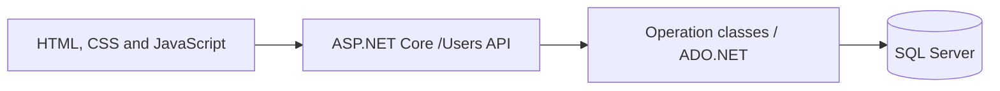

# SkillYouth

**My first .NET project — built for my college Community Enhancement Project (CEP).**

SkillYouth is a web-based skill-development and learning platform created with the aim of making learning more accessible to underprivileged youth. Learners can explore courses, enroll, work through lessons and track their completion. An admin dashboard provides tools for managing courses, lessons and learner information.

This project marks the beginning of my .NET journey: connecting a JavaScript frontend to an ASP.NET Core API, writing SQL queries, working with relational data and building a complete learning workflow.

## Features

### For learners

- Account registration and login, with BCrypt password hashing and verification.
- A course catalogue with descriptions, durations and course images.
- Course enrollment and a personal list of enrolled courses.
- A dashboard showing learner details, level and joining date.
- An ordered lesson player with formatted content and code highlighting.
- Lesson completion tracking and a calculated course-progress percentage.
- Light and dark themes, with the preference saved in the browser.

### For admins

- Admin login and separate admin-management screens.
- Learner listings with student levels and joining dates.
- Course creation, editing and deletion, including image uploads.
- Rich-text lesson creation with Quill, lesson ordering and optional header images.
- Course totals and a popular-course summary based on enrollment counts.
- Printable learner and course reports; the browser print dialog can save these as PDF.

> This is a college learning project. The admin interface includes role-related controls, but server-side authentication and permission enforcement need further work before public deployment. Browser storage flags are not a substitute for API authorization.

## Technology stack

| Area | Technology |
| --- | --- |
| Backend | C#, ASP.NET Core Web API; the current project targets .NET 10 |
| Database | Microsoft SQL Server |
| Data access | ADO.NET with `Microsoft.Data.SqlClient` and parameterized SQL queries |
| Frontend | HTML, CSS and vanilla JavaScript |
| Password handling | `BCrypt.Net-Next` |
| Lesson editor | Quill |
| Code highlighting | highlight.js |
| API description | ASP.NET Core OpenAPI, enabled in Development |

The frontend is served directly from `wwwroot` by the ASP.NET Core application. There is no separate frontend package installation or build step.

## How it fits together



The controller receives requests and delegates database work to operation classes. DTOs carry user, admin, course, enrollment, lesson and progress data between the frontend and backend.

## Project structure

```text
CEP/
├── README.md
├── CEP.sln
└── SkillYouth/
    ├── SkillYouth.csproj
    ├── SkillYouth.sln
    ├── Program.cs
    ├── ServerController/
    │   └── AuthController.cs      # Contains UsersController and /Users routes
    ├── Operation/                # Learner signup, login and dashboard queries
    ├── AdminOperation/           # Admin and course/user management
    ├── CourseOperation/          # Course creation and catalogue queries
    ├── EnrollmentOperation/      # Course enrollment
    ├── LessonOperations/         # Lessons, completion records and progress
    ├── AdminDTO/
    ├── UserDTO/
    ├── CourseDTO/
    ├── EnrollmentDTO/
    ├── Lesson/                   # Lesson and progress DTOs
    ├── Properties/
    │   └── launchSettings.json
    └── wwwroot/
        ├── index.html
        ├── courses.html
        ├── signup.html
        ├── login.html
        ├── dashboard.html
        ├── LearningModules.html
        ├── admin-login.html
        ├── admin-signup.html
        ├── AdminDashBoard.html
        ├── download-report.html
        ├── downloadCourse-Report.html
        ├── styles.css
        ├── js/
        └── images/courses/
```

**Solution note:** the root `CEP.sln` currently has no project entry. Use `SkillYouth/SkillYouth.csproj` for CLI commands, or open `SkillYouth/SkillYouth.sln` in Visual Studio.

## Run locally

### Requirements

- The .NET 10 SDK.
- A running SQL Server instance and a database matching the application's queries.
- A modern browser.
- Internet access for NuGet restore and the externally hosted fonts, Quill and highlight.js assets used by some pages.

### 1. Open the application folder

From the repository root:

```powershell
cd .\SkillYouth
```

### 2. Prepare the database

The repository currently does **not** include a database-creation script, migration history or seed script. You will need the original database/schema export, or a compatible database, before database-backed features can work.

The source queries reference these tables:

| Table | Purpose |
| --- | --- |
| `Users` | Learner names, emails and password hashes |
| `DashBoard` | Learner level and joining date, associated with a user |
| `Admins` | Admin accounts, password hashes, roles and joining dates |
| `Courses` | Course titles, descriptions, durations and image paths |
| `Enrollments` | Learner-to-course enrollment records and enrollment dates |
| `CourseLesson` | Ordered lesson content and optional header images |
| `LessonProgress` | Completed lessons for each learner |

This list describes the queries, not a complete database schema. The original column types, keys, defaults, constraints and any triggers must also be supplied. In particular, the learner dashboard expects a `DashBoard` row associated with the user; registration currently inserts into `Users` only.

### 3. Configure the connection string

The application reads `ConnectionStrings:DefaultConnection`. For a Windows-authenticated local development database, set a process environment variable in the same PowerShell terminal:

```powershell
$env:ConnectionStrings__DefaultConnection = 'Server=YOUR_SQL_SERVER;Database=YOUR_DATABASE;Integrated Security=True;Encrypt=True;TrustServerCertificate=True'
```

Replace the server and database placeholders with your local values. `TrustServerCertificate=True` is for a local development instance using its development certificate. Use appropriate certificate validation for a hosted environment. Keep database credentials out of commits.

### 4. Restore, build and run

```powershell
dotnet restore SkillYouth.csproj
dotnet build SkillYouth.csproj
dotnet run --project SkillYouth.csproj --launch-profile http
```

Open **[http://localhost:5080](http://localhost:5080)**. The root route redirects to `index.html`.

Serve the pages through this application so same-origin API calls resolve correctly. Several admin and report scripts explicitly reference `http://localhost:5080`, so keep that address for the current local version.

In Development, the OpenAPI document is available at **[http://localhost:5080/openapi/v1.json](http://localhost:5080/openapi/v1.json)**. The project exposes the JSON specification; it does not configure a Swagger UI page.

## Main API routes

All routes are under `/Users`.

| Method | Route | Purpose |
| --- | --- | --- |
| POST | `/Users/signup` | Register a learner |
| POST | `/Users/login` | Verify learner credentials |
| GET | `/Users/dashboard/{userid}` | Read learner dashboard details |
| POST | `/Users/AdminLogin` | Verify admin credentials |
| POST | `/Users/AdminSignUp` | Admin registration; prototype permission handling |
| GET | `/Users/AdminDashBoard/{AdminId}` | Read admin details |
| GET | `/Users/AdminDashBoard/ShowUser` | List learners |
| POST | `/Users/upload-image` | Upload a course image |
| GET | `/Users/get-all-courses` | Read the course catalogue |
| POST | `/Users/add-course` | Create a course |
| PUT | `/Users/update-course` | Update a course |
| DELETE | `/Users/delete-course/{CourseId}` | Delete a course |
| GET | `/Users/AdminDashBoard/showCourse` | Read admin course listings |
| GET | `/Users/AdminDashBoard/PopularCourse` | Read the most-enrolled course summary |
| POST | `/Users/enroll-course` | Enroll a learner |
| GET | `/Users/my-courses/{userid}` | Read a learner's enrolled courses |
| POST | `/Users/{courseid}/lessons` | Add a lesson |
| GET | `/Users/{courseid}/lessons` | Read ordered lessons |
| POST | `/Users/lessonprogress` | Record lesson completion |
| GET | `/Users/completed-lesson/{userid}` | Read completed lesson IDs |
| GET | `/Users/{courseid}/progress/{userid}` | Read total and completed lesson counts |

## What I learned

- Building controller-based APIs with ASP.NET Core and dependency injection.
- Connecting frontend pages to backend endpoints with `fetch`.
- Writing parameterized SQL queries, joins, counts and data mappings.
- Hashing and verifying passwords with BCrypt.
- Modelling relationships between users, courses, enrollments and lessons.
- Integrating rich-text editing, image uploads and progress indicators.
- Separating request DTOs, controller actions and database operation classes.
- Understanding the difference between frontend login state and server-enforced permissions.

## Current scope and future improvements

As an early learning project, this version still has areas to improve:

- Add authenticated server sessions or tokens and enforce API permissions and record ownership.
- Include a reproducible database schema and initial setup data.
- Validate rich-text content, render it safely, and restrict uploaded file types and sizes.
- Replace fixed localhost API URLs with consistent same-origin requests.
- Refine form handling, shared scripts, empty states and dashboard statistics; some statistics are placeholders.
- Add automated tests and review dependency versions.

These are development goals, not features claimed to be complete.

## Author

**Tanish Gupta** — learning by building, starting with SkillYouth.

- [GitHub](https://github.com/Tanish15-gif)
- [LinkedIn](https://www.linkedin.com/in/tanish-gupta09)

